# FTC
FTC código de los niveles.

## FTCintro😶‍🌫️

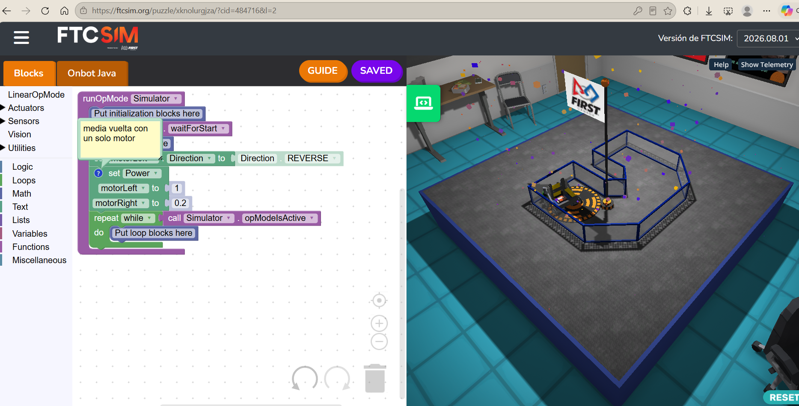
En este nivel se trató de dar nuestros fundamentos para avanzar y dar giros en si como usar los motores correctamente.

## FTCmovimientos🚶

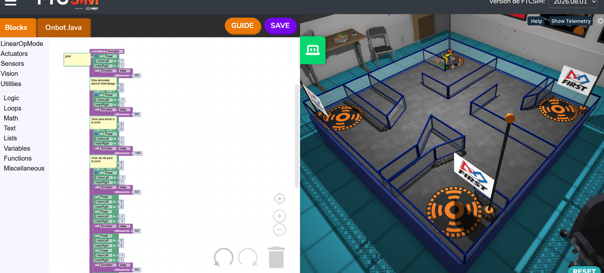
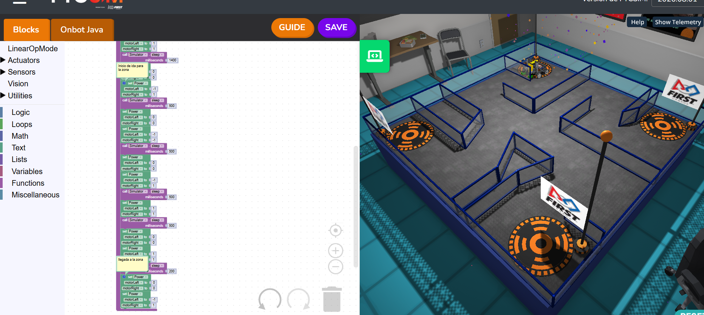
En estos niveles de la sección de movimientos no plantearon retos para mejorar la comprención del movimiento del robot además de presentarnos el bloque "sleep" 
que literal mente duerme al robot u le indica cuanto tiempo debe de hacer x acción/bloque.

## FTCsensores🟥🟦

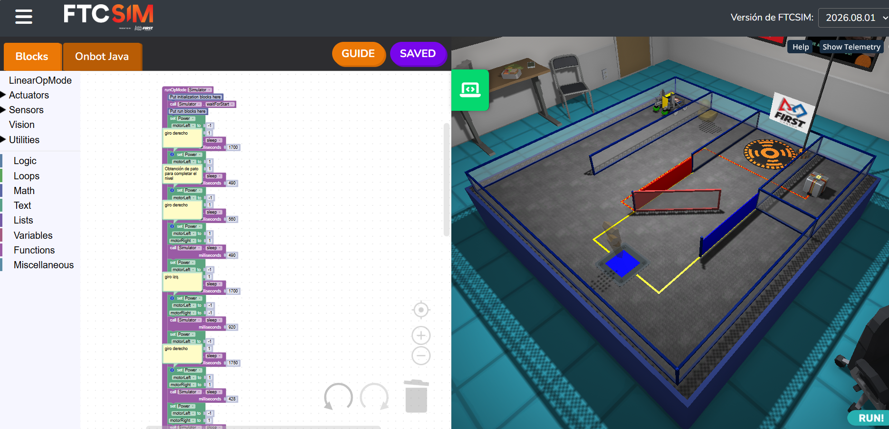
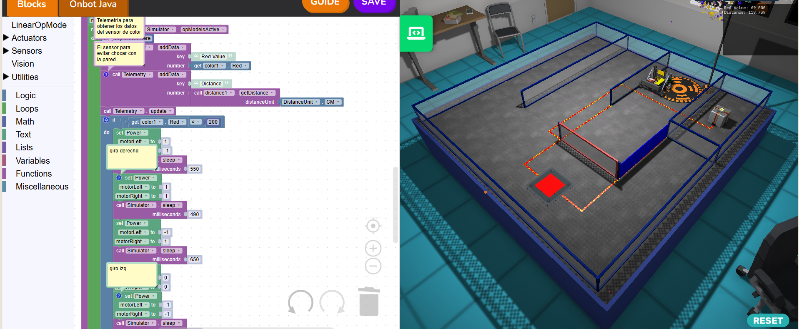
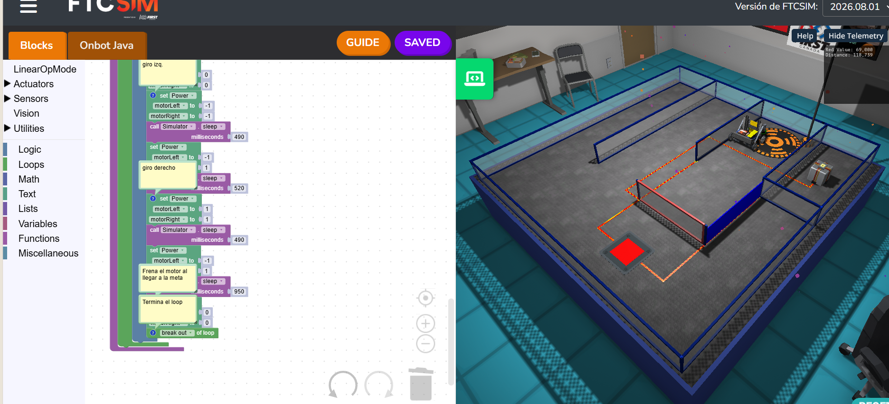

En este nivel de sensores aplicamos 2 nuevos bloques al inicio uno de colores y al final uno de distancia donde se guiaban de telemetrías dadas por el simulador donde se ponía también el bloque IF-do además de ya usarse el bloque de loop y enseñarnos a terminar el bloque loop y con esto se cerraría las bases del simulador donde se enseñó el cómo moverte adelante atrás, cómo moverse de lado giro derecho etc. Y como usar sensores.

## FTCpuzles🧩

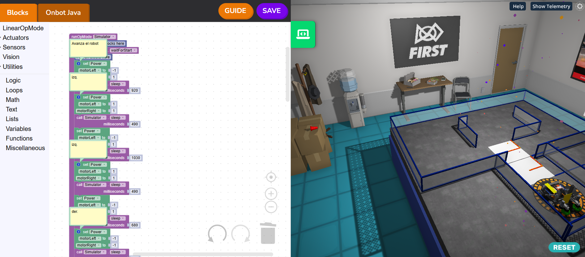
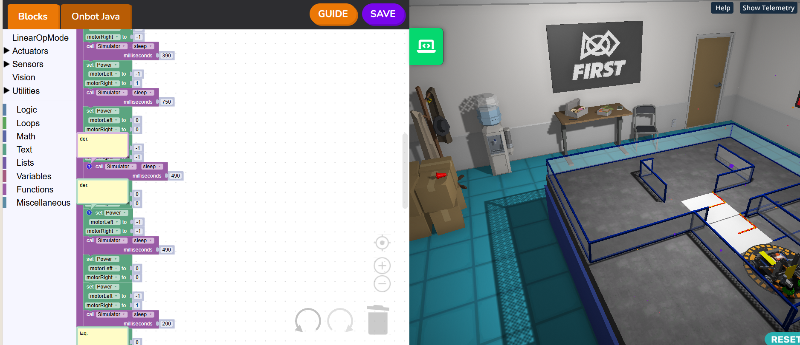
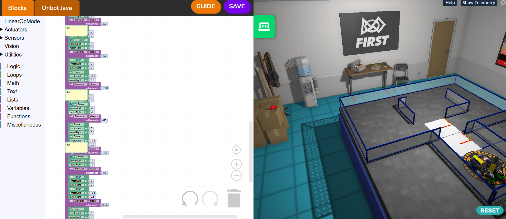

En este nivel con lo aprendido fue resolver puzles subiendo poco a poco de dificultad prácticamente usando las bases como para reforzar lo aprendido.

## FTCGrabby🏗️

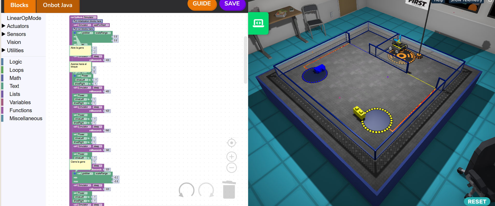
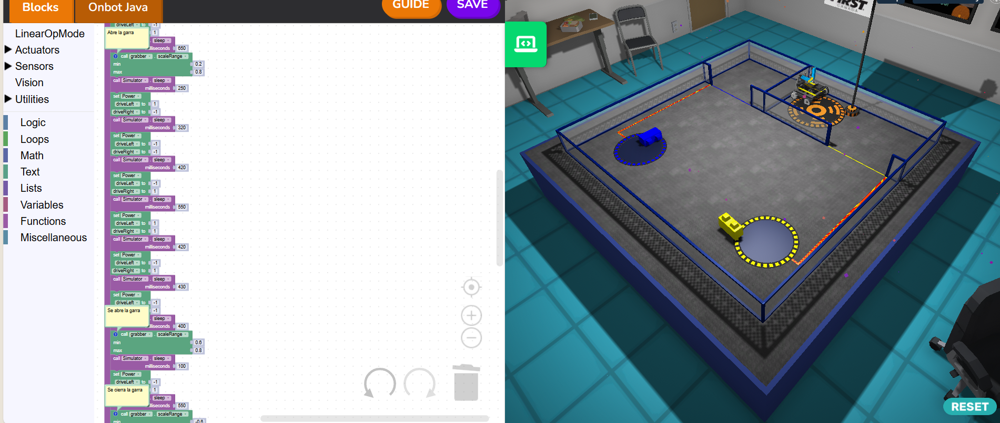
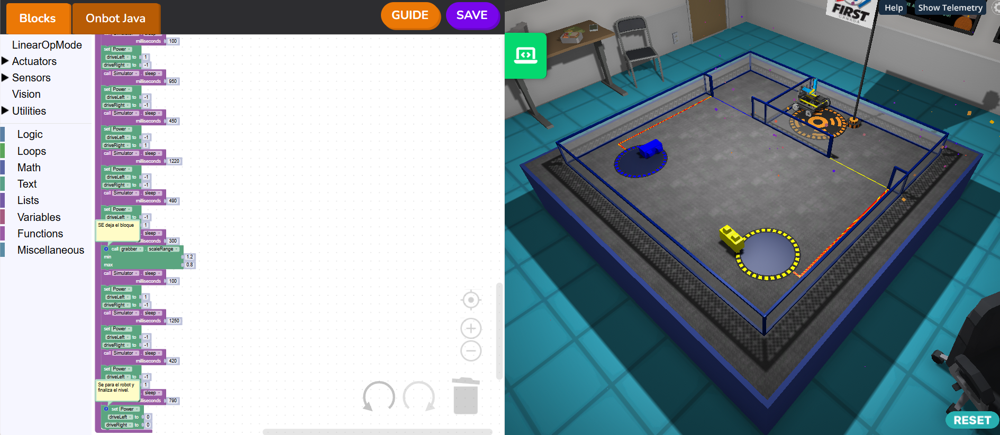

En este nivel grabby empezamos con un nuevo bloque que activaba la garra y que iba a hacer vital para completarlo, además de estar en conjunto con todas las demás bases teniendo desde mover a un bloque hasta usar sensores, movimientos, garra. Para mover los bloques que abran puertas y con ello llegar a la meta. Es decir usamos todo lo aprendido y reforzado en los puzles y sumarlos al nuevo bloque de la garra para completar los niveles y terminar el simulador.
